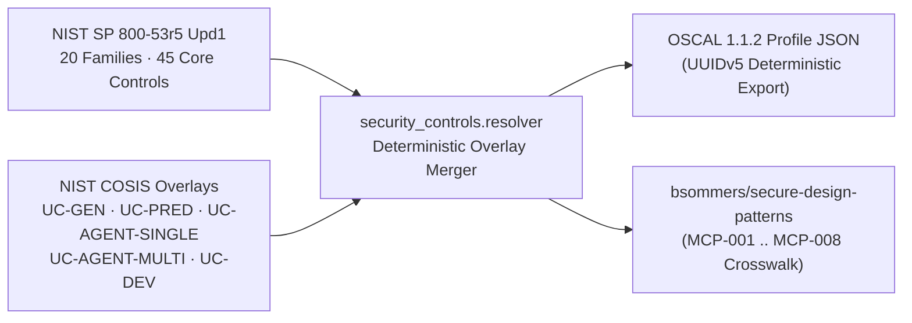

# Security Controls Library (`NIST SP 800-53r5 Update 1` + `COSIS`)

> **Deterministic, machine-validated security & privacy control catalog, NIST COSIS AI/SI use-case overlays, OSCAL 1.1.2 Profile exporter, and secure-design-pattern crosswalk.**

[](https://csrc.nist.gov/pubs/sp/800/53/r5/upd1/final)
[](https://csrc.nist.gov/projects/cosis/use-cases)
[](src/security_controls/oscal.py)
[](LICENSE)

---

## Overview

`security-controls` provides a zero-fabrication, Python-stdlib-executable compliance and architecture control engine grounded in two authoritative NIST sources:

1. **[NIST SP 800-53 Rev. 5, Update 1 (Final)](https://csrc.nist.gov/pubs/sp/800/53/r5/upd1/final)** — *Security and Privacy Controls for Information Systems and Organizations*, modeling all **20 official control families** (`AC` through `SR`, including `PM` Program Management and `PT` PII Processing and Transparency) and **45 core controls & enhancements** tagged with SP 800-53B baselines (`low`, `moderate`, `high`, `privacy`).
2. **[NIST COSIS Use Cases](https://csrc.nist.gov/projects/cosis/use-cases)** — *SP 800-53 Control Overlays for Super Intelligence Systems* (formerly *Control Overlays for Securing AI Systems / COSAiS*), providing tailored control selections, parameter assignments, assessment checks, and pattern crosswalks across all **five official COSIS use cases**:
   - **`UC-GEN`** — Adapting and Using Generative SI – Assistant / Large Language Model (LLM)
   - **`UC-PRED`** — Using and Fine-Tuning Predictive SI
   - **`UC-AGENT-SINGLE`** — Using SI Agent Systems (SI Agents) – Single Agent
   - **`UC-AGENT-MULTI`** — Using SI Agent Systems (SI Agents) – Multi-Agent
   - **`UC-DEV`** — Security Controls for SI Developers *(aligned with NIST SP 800-218 / 800-218A SSDF)*



---

## Quick Start

```bash
# 1. Clone & validate all catalogs, 20 families, 5 COSIS overlays & Markdown links (stdlib only)
git clone https://github.com/bsommers/security-controls.git
cd security-controls
python3 scripts/validate_controls.py

# 2. Inspect catalog summary
PYTHONPATH=src python3 -m security_controls.cli summary

# 3. Resolve effective controls for a Single-Agent + SI-Developer system at High baseline
PYTHONPATH=src python3 -m security_controls.cli resolve \
  --use-case UC-AGENT-SINGLE \
  --use-case UC-DEV \
  --baseline high

# 4. Export a deterministic NIST OSCAL 1.1.2 Profile JSON
PYTHONPATH=src python3 -m security_controls.cli export-oscal \
  --use-case UC-AGENT-MULTI \
  --output output/uc-agent-multi.oscal-profile.json

# 5. Print bidirectional MCP-001..008 secure-design-pattern crosswalk
PYTHONPATH=src python3 -m security_controls.cli crosswalk

# 6. Run test suite, linter & strict typecheck
uv run pytest -v
uv run ruff check src scripts tests
uv run mypy --strict -p security_controls -p scripts
```

---

## Repository Layout

| Path | Purpose |
|------|---------|
| [`catalog/sp800-53-r5-upd1/`](catalog/sp800-53-r5-upd1/families.json) | All 20 NIST SP 800-53r5 Update 1 families (`families.json`) & 45 grounded controls (`core-controls.json`) |
| [`catalog/cosis/`](catalog/cosis/use-cases.json) | Official 5 NIST COSIS use cases (`use-cases.json`) & per-use-case control overlays (`overlays/*.json`) |
| [`schema/`](schema/control-catalog.schema.json) | JSON Schema `2020-12` contracts for SP 800-53r5 controls and COSIS overlays |
| [`src/security_controls/`](src/security_controls/__init__.py) | Strictly-typed loader, baseline + multi-overlay resolver, OSCAL 1.1.2 exporter & CLI |
| [`scripts/validate_controls.py`](scripts/validate_controls.py) | Deterministic referential-integrity, OSCAL export & link verifier |
| [`tests/`](tests/test_security_controls.py) | Smoke, unit, integration & torture test suites |
| [`docs/`](docs/README.md) | [Architecture](docs/ARCHITECTURE.md), [COSIS Use Cases](docs/COSIS_USE_CASES.md), [Pattern Crosswalk](docs/CROSSWALK_MCP_PATTERNS.md), [Roadmap](docs/ROADMAP.md) & **[M1 Research Spike Plan](docs/plans/01-research-spike-oscal-cosis-automated-overlay-compilation.md)** |
| [`input/`](input/README.md) / [`output/`](output/README.md) | Upstream `usnistgov/oscal-content` fetch target & reproducible OSCAL profile output directory |

---

## Next Milestone: `M1` Research Spike (`v1.1.0`)

See **[`docs/ROADMAP.md`](docs/ROADMAP.md)** and **[`docs/plans/01-research-spike-oscal-cosis-automated-overlay-compilation.md`](docs/plans/01-research-spike-oscal-cosis-automated-overlay-compilation.md)** for the active **Milestone M1 Research Spike** covering:
- **`RS-1`:** Streaming/compact indexing of the full `1,189`-control upstream `usnistgov/oscal-content` SP 800-53r5 catalog (`< 150 ms` load).
- **`RS-2`:** Strict two-tier provenance separation between NIST-published COSIS draft parameters and organization-specific pattern tailoring.
- **`RS-3`:** Official NIST OSCAL `1.1.2` JSON Schema (`oscal_profile_schema.json`) interoperability validation.
- **`RS-4`:** Automated SP 800-53A technical control assessment against [`bsommers/forge`](https://github.com/bsommers/forge) release bundles.

---

## Companion Repositories

- **[`bsommers/secure-design-patterns`](https://github.com/bsommers/secure-design-patterns)** — Specification-derived `mcp-serve` patterns (`MCP-001`–`MCP-008`) & runnable reference Python modules.
- **[`bsommers/forge`](https://github.com/bsommers/forge)** — OpenAPI 3.x to hardened FastMCP 4.x (`2026-07-28`) compiler & 5-gate verification harness.

## License

[MIT](LICENSE)
