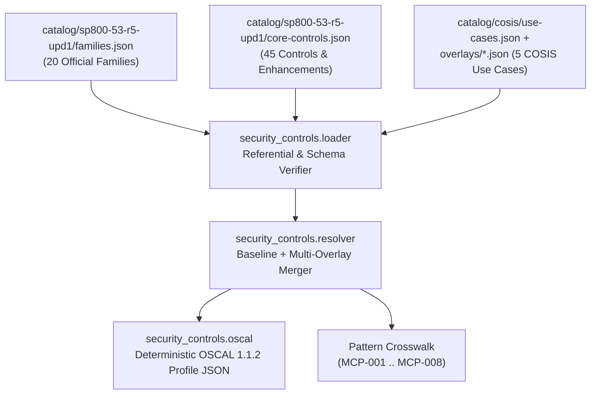

# Architecture — Security Controls Library (`security-controls`)

[← Back to Project README](../README.md) · [Documentation Hub](README.md) · [Milestone Roadmap](ROADMAP.md)

## 1. Design Principles

1. **Deterministic Compliance Decisions (`grounding-ai-outputs`):** Control resolution, baseline filtering, parameter substitution, and OSCAL 1.1.2 export are pure functions over version-controlled JSON catalogs (`same input -> byte-identical UUIDv5 OSCAL output`).
2. **Three-Repo Separation of Concerns:**
   - **[`bsommers/security-controls`](https://github.com/bsommers/security-controls)** *(this repo)*: Normative **NIST SP 800-53 Rev. 5 (Update 1)** controls, **NIST COSIS** AI/SI use-case overlays, and OSCAL 1.1.2 profile generation (*what security outcomes are required*).
   - **[`bsommers/secure-design-patterns`](https://github.com/bsommers/secure-design-patterns)**: Specification-derived architectural patterns (`MCP-001`..`MCP-008`) and reference Python modules (*how software architectures satisfy those controls*).
   - **[`bsommers/forge`](https://github.com/bsommers/forge)**: OpenAPI-to-FastMCP 4.x compiler, Golden Template, and 5-gate verifier (*automated build & runtime enforcement*).

## 2. Subsystem Pipeline

