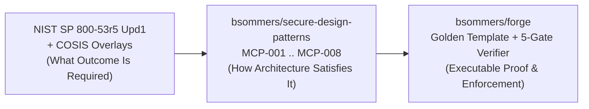

# Bidirectional Crosswalk: NIST SP 800-53r5 + COSIS ↔ `mcp-serve` Secure Design Patterns

[← Back to Project README](../README.md) · [COSIS Use Cases](COSIS_USE_CASES.md) · [Architecture](ARCHITECTURE.md)

This crosswalk connects **normative NIST SP 800-53 Rev. 5 (Update 1) controls** and **NIST COSIS use-case overlays** directly to the machine-validated engineering patterns in **[`bsommers/secure-design-patterns`](https://github.com/bsommers/secure-design-patterns)** and their concrete FastMCP 4.x enforcement in **[`bsommers/forge`](https://github.com/bsommers/forge)**.

---

## Traceability Matrix

| Pattern ID | Secure Design Pattern (`mcp-serve`) | Satisfied NIST SP 800-53r5 Controls | Applicable COSIS Overlays | Concrete Enforcement |
|------------|-------------------------------------|-------------------------------------|---------------------------|----------------------|
| **`MCP-001`** | **Server-Bound Credential Isolation & Per-Route Auth Dispatch** | `AC-6`, `AU-3`, `IA-5`, `IA-9`, `IR-4`, `MP-2`, `SA-8` | `UC-GEN`, `UC-PRED`, `UC-AGENT-SINGLE`, `UC-AGENT-MULTI`, `UC-DEV` | Server env-bound `RouteDispatchAuth`; zero-header `security: []`; anti-passthrough contract |
| **`MCP-002`** | **Immutable Chassis & Narrow Agent Overlay** | `AC-6(1)`, `CA-2`, `CM-2`, `CM-5`, `SA-8`, `SC-39`, `SI-7`, `SI-7(1)`, `SR-3` | `UC-PRED`, `UC-AGENT-SINGLE`, `UC-AGENT-MULTI`, `UC-DEV` | `:ro` Golden Template + `LockedWorkspaceDigest` SHA-256 pre/post tamper guard |
| **`MCP-003`** | **Dual-Axis Structured Payload Bounding** | `AC-4`, `CA-7`, `SA-8`, `SC-5` | `UC-GEN`, `UC-AGENT-SINGLE`, `UC-AGENT-MULTI`, `UC-DEV` | `32 KiB` Pass 1 list-cardinality slicing + Pass 2 conservative UTF-8/`\uXXXX` wire truncation |
| **`MCP-004`** | **Cycle-Safe & Polymorphic Schema Projection** | `PT-2`, `SA-8`, `SA-15`, `SC-7`, `SI-10` | `UC-GEN`, `UC-PRED`, `UC-AGENT-SINGLE`, `UC-DEV` | Remote `$ref` SSRF block, `spec_dir` path confinement, `ancestor_refs` cycle stubs & `allOf` merge |
| **`MCP-005`** | **Composite Intent Tools & Active Toolset Budgets** | `AC-6(10)`, `CM-7`, `IA-9`, `SA-15`, `SC-5` | `UC-AGENT-SINGLE`, `UC-AGENT-MULTI`, `UC-DEV` | `<= 15` active tools per profile, server-side workflow joins & `destructiveHint=True` AppSec signoff |
| **`MCP-006`** | **Stateless Sessionless Execution & Async DI Safety** | `AC-4`, `IR-4`, `SC-5`, `SC-7` | `UC-GEN`, `UC-AGENT-SINGLE`, `UC-AGENT-MULTI` | `SEP-2575`/`SEP-2567` zero module globals + lifespan `async def get_http_client` pool |
| **`MCP-007`** | **Primitive RFC 9110 `x-mcp-header` Mirroring** | `AU-6`, `PT-2`, `SI-10` | `UC-GEN`, `UC-AGENT-MULTI` | `1*tchar` validation, sensitive-name blocklist & non-union primitive default (`str = ""`) |
| **`MCP-008`** | **Layered OS Sandbox & `stdio` Frame Hygiene** | `AU-3`, `AU-6`, `CA-2`, `CM-7`, `SA-11`, `SC-39`, `SI-10` | `UC-GEN`, `UC-AGENT-SINGLE`, `UC-AGENT-MULTI`, `UC-DEV` | `stderr`-only JSON logs, `SEP-2577` AST gate, subprocess `stdio` probe & kernel/container isolation |
