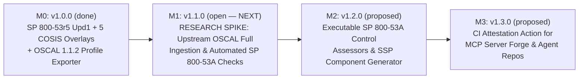

# Security Controls Library — Milestone Roadmap

> **Status Legend:** `done` = shipped & verified · `open` = next active milestone · `proposed` = planned follow-on

[← Back to Project README](../README.md) · [Documentation Hub](README.md) · [M1 Research Spike Plan](plans/01-research-spike-oscal-cosis-automated-overlay-compilation.md)

---

## Roadmap Progression

---

## Milestone Summary

| Milestone | Target | Status | Focus | Exit Gate Command |
|-----------|--------|:------:|-------|-------------------|
| **M0** | `v1.0.0` | `done` | **Core NIST SP 800-53r5 Update 1 & COSIS Use-Case Library** — All 20 control families, 45 grounded core controls/enhancements, all 5 NIST COSIS use-case overlays (`UC-GEN`, `UC-PRED`, `UC-AGENT-SINGLE`, `UC-AGENT-MULTI`, `UC-DEV`), deterministic multi-overlay resolver, OSCAL 1.1.2 Profile exporter, and `MCP-001..008` crosswalk | `python3 scripts/validate_controls.py && pytest -q` |
| **M1 (Next)** | `v1.1.0` | `open` | **Research Spike: Upstream NIST OSCAL 5.1.1+ Full-Catalog Sync, Evolving COSIS Draft Tracking & Automated SP 800-53A Assessment Rules** — Time-boxed empirical spike evaluating full 1,189-control `usnistgov/oscal-content` streaming ingestion, NIST COSIS draft publication schema alignment, and deterministic SP 800-53A evidence evaluators against forged MCP servers | `pytest -m "smoke or unit or integration" && python3 scripts/validate_controls.py` |
| **M2** | `v1.2.0` | `proposed` | **Executable SP 800-53A Assessors & OSCAL Component Definition / SSP Synthesis** — Turn M1 spike findings into automated control-assessment probes emitting OSCAL `assessment-results` JSON | `pytest -q` |
| **M3** | `v1.3.0` | `proposed` | **Cross-Repo Compliance Gate (`forge` + `secure-design-patterns` + `security-controls`)** — Emit signed OSCAL System Security Plan (SSP) fragments during `forge.orchestrator` Stage 5 | `pytest -q` |

---

## Execution Blueprints (`docs/plans/`)

- **[Plan 01 — Research Spike: Upstream NIST OSCAL Full Ingestion, COSIS Draft Alignment & Automated SP 800-53A Control Assessment (`Milestone M1`)](plans/01-research-spike-oscal-cosis-automated-overlay-compilation.md)** (`status: open`) — Research questions, four falsifiable hypotheses, spike prototypes, non-fabrication guardrails, and Go/No-Go decision gates for `M2`.
